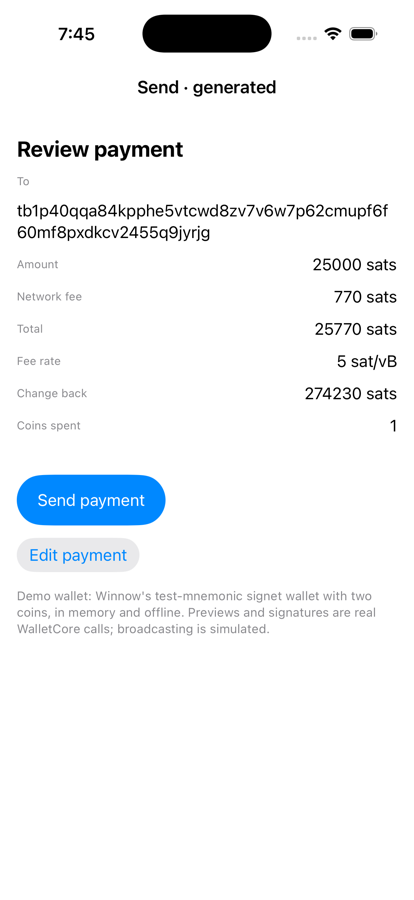

# Send — Winnow's Send review flow, with commands

The single-signature Send flow of the [Winnow](https://github.com/winnowwallet/winnow) wallet
(`Sources/WinnowApp/SendView.swift`, `AppModel.previewSend`, `AppModel.send(preview:)`), written as
an ElmLean app with commands. Type an address and an amount in sats, pick a fee priority, review the
payment, approve it, and the wallet authenticates you, signs and broadcasts. The wallet itself is
Winnow's WalletCore, behind commands; the app decides what to ask for and what to accept.



The headline theorem: **what you approve is what gets signed, and only a transaction matching it is
broadcast**, over every interleaving of taps and host answers, including host answers that lie.

```
Send/App.lean              the app: Model, Msg, Cmd, HostMsg, update, cmds, view (`Send.app : CmdApp …`)
Send/Proofs/Checks.lean    what `authorizes` and `matchesForm` mean, in `=` and `List.Perm`
Send/Proofs/Model.lean     one step: the invariant, which message asks for which command, the view
Send/Proofs/Run.lean       every run: signing and broadcast provenance
Send/Selftest.lean         host-answer samples (for the self-test and lockstep) and a scripted run
Send/Gate.lean             the axiom gate
generated/                 elmgen's output (types, update, view, cmds, JSON codecs, SendScreen)
ios/App/                   the hand-written shell and host: SendWallet (WalletCore), WalletHost (authentication)
hosttest/                  the host test: generated app + SendWallet against WalletCore on macOS
```

## The flow, and who does what

| Step | The app (Lean, proven) | The host (Swift, trusted) |
|---|---|---|
| Form | `setDestination`, `setAmount`, `setPriority`; "Review payment" when both fields are non-empty | — |
| Review payment | `preview id entry` | Winnow's `previewSend`: decode the address, resolve the fee rate, coin selection. Answers `previewReady d` or `previewFailed` |
| Draft arrives | shown for review **only if** it answers the pending request and matches the form: same inputs, the amount prints as the digits typed, the address is the one typed; otherwise the payment fails | — |
| Send payment | `sign d`, with the draft on screen | authenticate the owner (Face ID / passcode), then Winnow's `buildSend` (rebuilds and signs). Answers `signed s`, a summary read from the signed transaction, or `signFailed` |
| Signed | `broadcast d.id s.raw` **only if** `authorizes d s` (Winnow's `SendPreview.authorizes`, here in Lean); otherwise "does not match the reviewed payment. Nothing was sent." | — |
| Broadcast | the sent screen with the txid | broadcast, then Winnow's `commit` |

Editing anything on the review screen goes back to the form, and a late draft for the old inputs is
ignored. While a payment is being signed or sent, the form is frozen.

## What is proven

`Send/Gate.lean` asserts each theorem below and scans every theorem under `ElmLean` and `Send`
(574 theorems, standard axioms only).

| Theorem (namespace `Send`) | Plain-language guarantee |
|---|---|
| `sign_approved` | **Every signing request is an approval of what was on screen.** If any step of any run asks the host to sign draft `d`, that step is the user's in-sync "Send payment" event on the view the client was shown, that view is `reviewView d`, and `d` matches the form: same inputs, the amount on screen is the number typed and the address is the one typed. |
| `broadcast_approved` | **Every broadcast is of a transaction that matches an approved review.** If any step of any run asks the host to broadcast `raw`, that step is the host's report `signed s` of exactly `raw`, `s` `authorizes` a draft `d`, and an earlier step of the same run was the user's "Send payment" on the review screen of that very `d`, which matched the form. |
| `authorizes_iff` | `authorizes d s` means: `s` answers `d`, same fee, same change amount, the same coins (as a multiset), and its outputs are exactly the payment of `d.amount` sats to `d.script` plus `d`'s change, in some order, with nothing else. |
| `reviewView_shows`, `sats_inj`, `reviewView_approve` | The review screen shows the address, the amount, the fee and the total of `d`, each as its own text; different amounts never print the same; its "Send payment" button is the control that approves. |
| `matchesForm_iff`, `update_inv` | The invariant: any draft on screen (review, signing, sending, sent) matches the form, preserved by every message from the user or the host. |
| `sign_mem`, `broadcast_mem`, `signing_from`, `signing_has_sign` | One-step facts behind the two headlines: exactly which message in which state asks for each command, and that the signing screen of `d` is only ever entered from the review of `d`. |
| `view_sat` | The view never emits a host message, and "Send payment" only while a draft is under review. |

The framework theorems they rest on (`ElmLean/Proofs/Cmd.lean`): `Session.step_origin` (every
message `update` runs is either dispatched by an in-sync control of the view the client sees, or the
host's answer through `app.host`), `CmdSpec.trace_origin` (the same along every run) and the trace
indexing lemmas.

## What is trusted, not proven

* **The host's answers.** `d.script` is the host's decoding of the address the user typed, and the
  change output is the host's choice: the proof pins the address *string* and every amount, while
  where the sats land is WalletCore's `AddressDecoder` and change derivation, as in Winnow.
* **The signed summary.** `authorizes` checks what the host *reports* it signed. `SendWallet.sign`
  reads the outputs and inputs from the signed transaction and the fee from the coins it spends;
  `make host-test` checks that against real WalletCore and that seven kinds of tampered summary are
  refused.
* **Order and rate.** Inputs are compared as a multiset (Winnow pins their order). The fee rate is not
  pinned (Winnow doesn't pin it either); the fee in sats is.
* **Authentication** happens on the host before `buildSend`; the Lean app cannot see it. A simulator
  with no passcode set skips it (`WalletHost.authenticate`, `#if targetEnvironment(simulator)`).
* **Scope.** Single-signature wallet path only; Winnow's vault and MuSig2 approvals are out of scope.
* **The demo wallet.** The iOS app uses Winnow's test fixture (the all-zero test mnemonic on signet,
  two coins, in memory, no peers). Previews, signatures and `commit` are real WalletCore calls;
  broadcasting is simulated.

## Run it

```bash
make check       # gate · selftest · protocol harness · golden · generated CLI + lockstep · cross-check · host test
```

```bash
make ios         # the generated native app with the WalletCore host, in the iPhone simulator
```

`WINNOW` names the Winnow checkout to build the host against (default `~/src/winnow-claude`; tested
at commit `9cca3fc`). Lockstep runs 3,000 steps per seed here, half of them host answers drawn from
`Send.Selftest.samples`. Most walks end at the form or the review; across the two seeds about
fifteen steps reach signing and about six reach broadcast. The success path end to end is
`make host-test`'s job.
